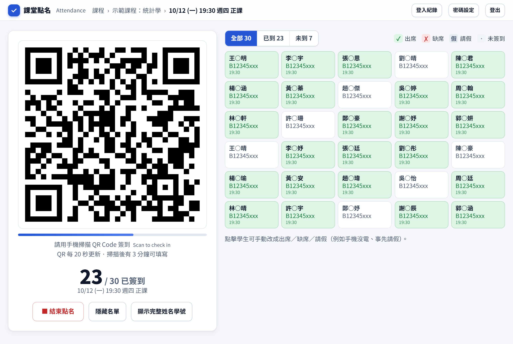
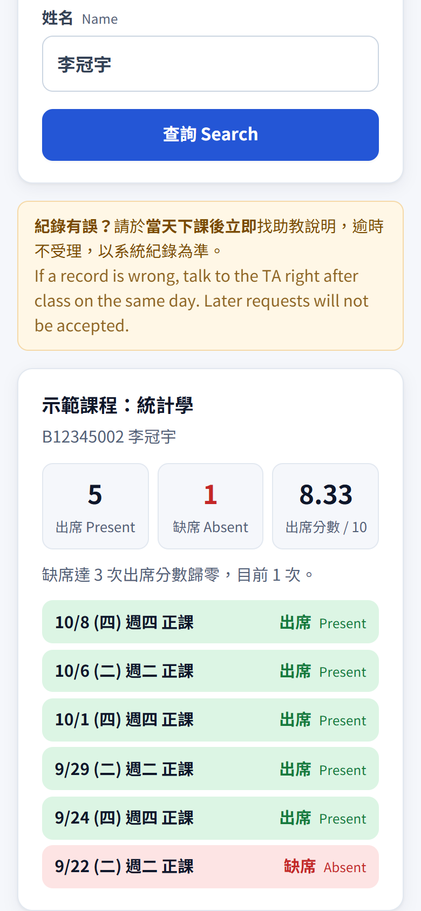
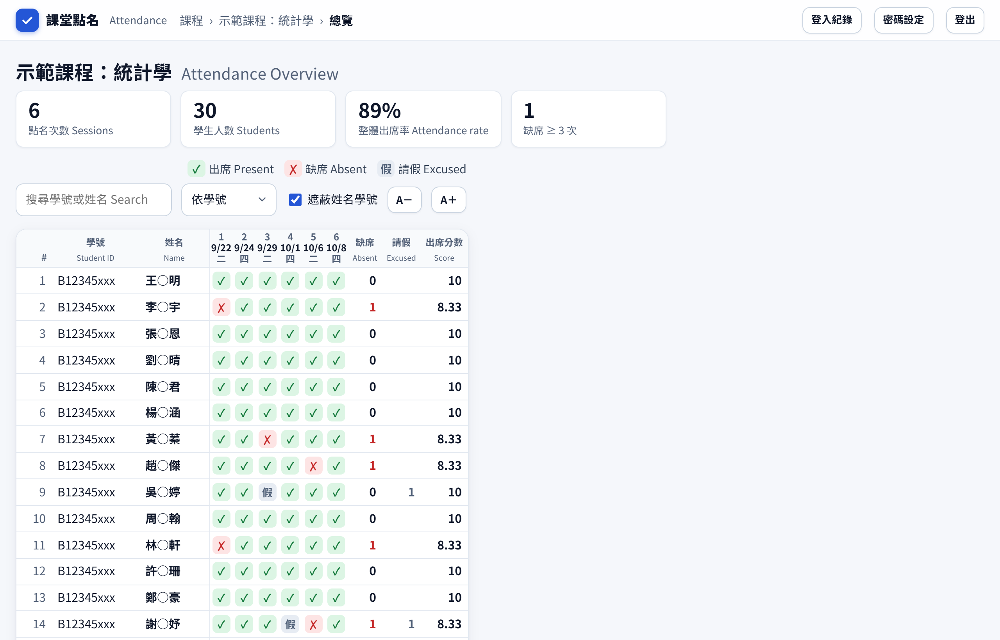
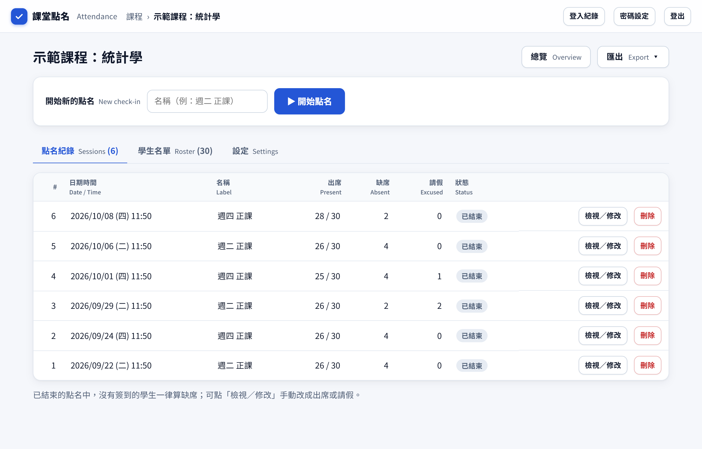

# 課堂點名系統 Classroom Attendance

給大學老師與助教用的 QR Code 點名系統。下課時投影 QR Code，學生用手機掃描並輸入學號、姓名就完成簽到，系統會**依你設定的規則自動算出席分數**。

- 學生不用裝 App，手機瀏覽器就能簽到，也能自己上 `/me` 查詢出席紀錄
- QR Code 每 20 秒更新一次，一支手機每次只能幫一個學號簽到，避免代簽
- 計分規則可以自訂：滿分、每缺一次扣幾分（或平均分攤），缺幾次歸零
- 匯出 Excel／CSV、匯入學生名單與過往點名紀錄
- 個資保護：兩組密碼分權、投影畫面遮蔽姓名、資料到期自動刪除、登入紀錄
- 部署在**你自己的** Cloudflare 帳號，學生資料只存在你那裡；免費額度就夠一般課程使用

**👉 [線上示範](https://lz-cpu326.github.io/Attendance/)**（資料只存在你的瀏覽器，不會上傳）

| 下課投影 QR Code，即時看到誰已簽到 | 學生用手機查詢自己的出席與分數 |
|---|---|
|  |  |

| 總覽：每次點名結果與自動算好的出席分數 | 點名紀錄 |
|---|---|
|  |  |

（截圖皆為示範用假資料；投影與總覽畫面預設遮蔽姓名與學號）

## 一鍵部署

[](https://deploy.workers.cloudflare.com/?url=https://github.com/LZ-cpu326/Attendance)

1. 按上面的按鈕，用 Cloudflare 帳號登入（沒有帳號就免費註冊一個）。
2. 依畫面指示建立。過程中會請你填兩個值：
   - `ADMIN_PASSWORD`：老師的後台密碼，**至少 10 個字元**，之後可以在後台修改
   - `SECRET`：隨便打一長串亂數字（至少 32 字元），用來簽署 QR Code 與登入憑證
3. 完成後會得到一個網址，例如 `https://attendance.你的帳號.workers.dev`。
   - 老師後台：`/admin/`
   - 學生查詢出席：`/me/`

資料庫會在第一次使用時自動建立，不需要另外執行 SQL。

## 用指令部署（進階）

```bash
git clone https://github.com/LZ-cpu326/Attendance.git
cd Attendance
npm install
npx wrangler login
npx wrangler secret put ADMIN_PASSWORD
npx wrangler secret put SECRET
npx wrangler deploy
```

`wrangler.toml` 沒有寫 `database_id`，第一次部署時 Wrangler 會自動在你的帳號建立 D1 資料庫。之後改程式，只要再執行 `npx wrangler deploy` 就好。

## 本機開發

```bash
cp .dev.vars.example .dev.vars   # 填入本機用的密碼
npm run dev                      # http://localhost:8787/admin/
npm run demo                     # 產生 GitHub Pages 示範版到 _site/
```

## 使用方式

### 兩組密碼

| | 後台密碼（≥10 字元） | 點名密碼（6–9 字元） |
|---|---|---|
| 在哪裡輸入 | 只在自己的手機／電腦 | 學校電腦投影 |
| 能做什麼 | 全部功能 | 開始／結束點名、投影 QR Code、看已簽到人數 |
| 學生資料 | 看得到 | **完全看不到**（API 只回傳人數） |

登入頁只有一個欄位，系統會依密碼長度判斷是哪一組。點名密碼要先把後台密碼改成 10 字元以上，才能在「密碼設定」裡設定。

### 點名規則

- QR Code 每 20 秒更新；學生掃到後有 3 分鐘可以填寫（`src/worker.js` 的 `ROT_MS`、`TICKET_MS`）
- 學號和姓名要跟名單相符；系級只做紀錄，不比對
- 同一支手機（cookie＋localStorage）每次點名只能簽一個學號
- 點名結束時沒簽到的人算缺席；請假不扣分；助教可以手動補登

### 出席分數

在各課程的「設定」頁可以調整：

- **扣分方式**：平均分攤（滿分 ÷ 總次數）或每次固定扣 X 分
- **歸零規則**：缺席達 N 次直接 0 分，也可以關閉
- **總次數**：可以填整學期預計的點名次數，或用實際已點名次數計算

### 資料保存

- 課程（名單＋點名紀錄）在**建立後 12 個月**自動刪除；若最後一次點名距到期不到 2 個月，會延到那次點名後 2 個月。每天台灣時間 03:00 由排程執行（`KEEP_MONTHS`、`AFTER_MONTHS`）
- 「登入紀錄」保存一年：登入成功／失敗、鎖定、改密碼、匯入名單、匯出、刪除課程、到期自動刪除

## 資安設計

- **登入鎖定**：同一 IP 15 分鐘內最多嘗試 10 次。成功登入過的裝置會拿到 `adt` cookie（180 天），改用裝置計算次數，校園網路裡有人亂試密碼也鎖不到老師的手機。學校電腦被鎖住時，用手機登入後台 →「密碼設定」→「解除鎖定」
- **頻率限制**（`wrangler.toml` 的 `[[ratelimits]]`）：簽到 300 次/分鐘（全班共用校園 IP，所以上限放寬），查詢 120 次/分鐘
- **嚴格 CSP**（`public/_headers`）：只允許載入本站程式、禁止被其他網站內嵌。頁面不能寫內嵌 `<script>` 或 `onclick=`，程式一律放在獨立的 .js 檔
- 密碼以 PBKDF2 雜湊儲存；改密碼後，該身分在其他裝置的登入會自動失效
- 投影畫面與總覽頁預設遮蔽姓名第 2 字與學號末 3 碼

### 忘記密碼／緊急解鎖

```bash
# 忘記後台密碼：刪掉後退回用 ADMIN_PASSWORD 登入
npx wrangler d1 execute attendance --remote --command "DELETE FROM settings WHERE key='admin_pw'"
# 解除所有登入鎖定
npx wrangler d1 execute attendance --remote --command "DELETE FROM login_fail"
```

## 示範版是怎麼做的

`demo/build.mjs` 把 `public/` 複製到 `_site/`，並在每一頁最前面載入 `demo/shim.js`。shim 會攔截頁面對 `/api/` 的請求，直接在瀏覽器裡執行同一份 `src/worker.js`，資料庫則用 [sql.js](https://github.com/sql-js/sql.js)（SQLite）模擬 D1。所以示範版和正式版的程式邏輯完全相同。推到 `main` 後，GitHub Actions 會自動發布到 GitHub Pages。

## 一起改善

歡迎開 Issue 回報問題或提出建議，也歡迎發 Pull Request。修改時請注意：

- **個資優先**：任何改動都不能讓未登入的人或點名密碼取得學生名單與出缺席紀錄
- 介面以中文為主，重要欄位附英文

## 支持這個專案

如果這個系統幫你省下點名的時間，歡迎[請我喝杯咖啡 ☕](https://vocus.cc/pay/donate/@zhiheng?donateSourceType=exclusiveLink)（透過方格子贊助，不需註冊帳號，可用 LINE Pay 或 PayPal）。

## 授權

[AGPL-3.0](LICENSE)。你可以自由使用、修改、部署；如果把修改過的版本架設成服務給別人使用，必須同樣以 AGPL-3.0 公開修改後的原始碼。
